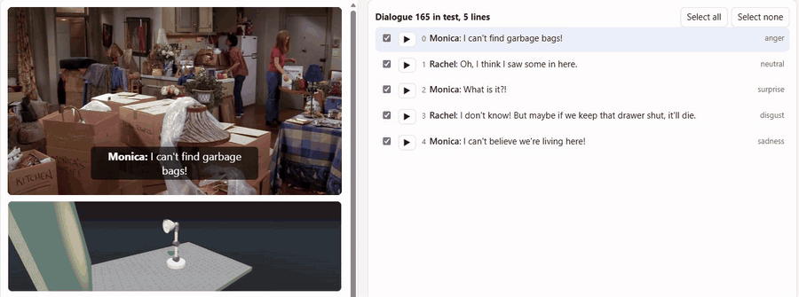
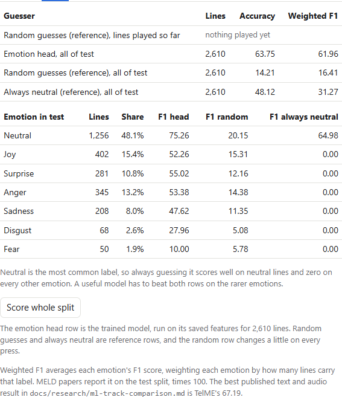

# MELD emotion prototype: words and voice in, emotion and a reply out

This repository is a take-home submission for the ML route described in `ML_route/README.md`, on the text plus audio track. Each MELD clip goes through Whisper, which turns its sound into words. Three frozen encoders then turn the words and the sound into features. A small head trained in Rust picks one of MELD's seven emotions, and a small language model writes a short reply for that emotion.

The whole inference path holds about 2.8 billion learned parameters, under the brief's limit of 6 billion.

| Part | Model | Parameters |
|---|---|---:|
| Speech to text | Whisper large-v3-turbo (int8) | 808.9M |
| Text encoder | EmoBERTa-large | 355.4M |
| Text encoder | EmbeddingGemma-300m | 302.9M |
| Voice encoder | HuBERT-large | 315.4M |
| Emotion head | trained here, in Rust | about 1M |
| Reply writer | LFM2.5-1.2B-Instruct | 1.17B |

The trained head scores 61.96 weighted F1 on MELD's test split (62.5 ± 0.8 across three seeds). EmoBERTa-large was released already trained on MELD, and its weights have likely seen MELD's test lines, so this score may be higher than the head would reach on new speech.

The SWE route in `SWE_route/` is a separate challenge and is not part of this submission. The player borrows only its desk lamp: the lamp's gesture library and 3D viewer are built into the player page, so the lamp under the video reacts to each line's emotion.



*Test dialogue 165 playing live on a GTX 1070 Ti. As each clip ends, Whisper hears the words, the head picks an emotion (right column, under MELD's own label in grey), LFM2.5 writes the reply, and the lamp plays a clip from that emotion's family.* The [Quick test](#quick-test) below shows how to run it.

## Quick test

The player page is committed ready-built at `ML_route/data/meld-player.html`, so you can test it without building anything.

1. **Get MELD.** Download and unpack it as in [step 1](#1-download-meld), so that `ML_route/data/MELD.Raw/output_repeated_splits_test/` exists. The page plays its clips from that folder.
2. **Open the page.** Double-click `ML_route/data/meld-player.html` to open it in a browser. Every dialogue, MELD's labels and Whisper's saved transcripts are built into the page, so you can play any test dialogue. Without the servers the models are off, so each line shows a random emotion marked "random" and a placeholder reply. Under the video, the SWE route's simulated desk lamp plays a short movement that matches each line's emotion, and the **Lamp** box turns it off.
3. **Turn on the models.** Create the two Python environments as in [step 2](#2-create-the-two-python-environments), and log in with `hf auth login` after accepting EmbeddingGemma's terms on Hugging Face. Then start the three servers as in [step 8](#8-run-the-live-player) and open http://127.0.0.1:8765/meld-player.html#test-149. Tick **Live speech-to-text**, **Live emotion** and **Live reply**, and play the dialogue. The committed head at `ML_route/heads/meld-head.json` is used, so no training is needed.

The Score tab's "Emotion head, all of test" row needs the joined features from steps 5 and 6, and shows only the reference rows without them. Training the head yourself takes steps 3 to 7.

## What you need

**Hardware:**
- A computer with an NVIDIA GPU.
  - The live player was tested on a GTX 1070 Ti with 8 GB.
  - Feature extraction ran on a Runpod A40 with 48 GB. An 8 GB card also works, more slowly.
- About 15 GB of free disk space for MELD and the features.

**Tools:**
- Python 3.12, with [uv](https://docs.astral.sh/uv/) to create the environments.
- Rust 1.92 or later, with `cargo`.
- `ffmpeg` on the `PATH`, used to decode the clips' audio.

## Steps to reproduce

Every command runs from the repository root unless a step says otherwise. On Windows, use `.venv/Scripts/python.exe`; on Linux and macOS, use `.venv/bin/python`.

### 1. Download MELD

Download `MELD.Raw.tar.gz` from https://web.eecs.umich.edu/~mihalcea/downloads/MELD.Raw.tar.gz.

1. Unpack it into `ML_route/data/`, which gives `ML_route/data/MELD.Raw/`.
2. Inside that folder, unpack `train.tar.gz`, `dev.tar.gz` and `test.tar.gz`. That gives:
   - `train_splits/` (9,989 clips);
   - `dev_splits_complete/` (1,112 clips);
   - `output_repeated_splits_test/` (2,747 clips).

The test folder also holds macOS `._*` stub files; the scripts skip them.

### 2. Create the two Python environments

The speech-to-text environment runs Whisper through faster-whisper:

```
uv venv --python 3.12 ML_route/text_fixes/.venv
uv pip install --python ML_route/text_fixes/.venv faster-whisper==1.2.1 numpy av nvidia-cublas-cu12 nvidia-cudnn-cu12
```

The model environment runs the encoders, the emotion server and the reply writer:

```
uv venv --python 3.12 ML_route/player/.venv
uv pip install --python ML_route/player/.venv torch --index-url https://download.pytorch.org/whl/cu126
uv pip install --python ML_route/player/.venv transformers==5.19.0 numpy safetensors sentencepiece av
```

PyTorch's cu126 build is the newest that still runs on older Pascal cards such as the GTX 1070 Ti. On a newer GPU, any recent CUDA build works.

### 3. Build the cleaned labels (MELD.Completed)

```
ML_route/text_fixes/.venv/Scripts/python.exe ML_route/text_fixes/apply_fixes.py
```

This writes `ML_route/data/MELD.Completed/` from `MELD.Raw`, and never changes `MELD.Raw`.

- **Every split:** it repairs MELD's broken punctuation characters.
- **Train and dev only:** it also applies the reviewed word fixes in `ML_route/text_fixes/fixes.csv` and the fixes taken from the audio in `ML_route/text_fixes/audio_fixes.csv`.
- **Test** keeps MELD's published words, so the test scores stay comparable with other MELD results.

`docs/research/meld-data-quality.md` explains how the fixes were made.

### 4. Transcribe every clip with Whisper (MELD.Whisper)

```
ML_route/text_fixes/.venv/Scripts/python.exe ML_route/text_fixes/transcribe.py
```

This writes `ML_route/data/MELD.Whisper/`: Whisper's transcript of every clip, as JSONL plus a copy of each label file with Whisper's words. The head reads Whisper's words rather than MELD's, because the live demo only ever has Whisper's words. Expect this to take a few hours on an 8 GB GPU. A rerun skips clips already done.

**Shortcut:** download `MELD.Whisper.zip` from the repository's [GitHub Release](https://github.com/jamesEmerson112/Human-Computer-Labs/releases/tag/data-v1) and unpack it into `ML_route/data/`.

### 5. Extract the encoder features

```
export MELD_DATA=ML_route/data MELD_FEATS=ML_route/data/feats MELD_AUDIO=ML_route/data/audio MELD_RESULTS=ML_route/data/results
cd ML_route/bench
../player/.venv/Scripts/python.exe audio_cache.py
../player/.venv/Scripts/python.exe features.py --text embeddinggemma-300m,emoberta-large --voice hubert-large --versions whisper
cd ../..
```

- `audio_cache.py` decodes every clip once to 16 kHz mono.
- `features.py` writes one feature file per encoder and split into `ML_route/data/feats/`:
  - EmbeddingGemma: the mean of its last layer over the line's tokens, 768 numbers.
  - EmoBERTa-large: the same pooling, 1,024 numbers.
  - HuBERT-large: its last layer and the mean of all its layers, each averaged over time, 2,048 numbers.
- **EmbeddingGemma is a gated model.** Accept its terms on Hugging Face and log in with `hf auth login` first.
- **Run time:** on an A40 this step takes under an hour. On an 8 GB card it takes a few hours.

**Shortcut:** download `feats.zip` from the same [GitHub Release](https://github.com/jamesEmerson112/Human-Computer-Labs/releases/tag/data-v1) and unpack it into `ML_route/data/`.

### 6. Join the features

```
ML_route/player/.venv/Scripts/python.exe ML_route/hello_world/prepare_features.py
```

This joins the three encoders' features for each clip into one row of 3,840 numbers, and writes them to `ML_route/data/fusion/`. One train clip and one dev clip have no audio and are left out.

### 7. Train the emotion head in Rust

```
cd ML_route/hello_world
cargo run --release
```

- **Settings:** training reads `hyperparameters.toml`. Each setting is commented, including the five extra training techniques that were measured and the scores behind keeping or dropping them.
- **What it does:** it trains for 2,000 steps, scores the dev split every 100 steps, keeps the head with the best dev score, then scores that head on test.
- **Output:** it saves the head to `ML_route/heads/meld-head.json`.
- **Time:** it takes about 2.5 minutes on a CPU. The `--release` flag matters, because a debug build is many times slower.
- **Tests:** `cargo test` checks the hand-written gradients against numerical ones.

**Shortcut:** the trained head is committed at `ML_route/heads/meld-head.json`, so steps 4 to 7 can be skipped to just run the player. Training writes to the same path.

### 8. Run the live player

The page `ML_route/data/meld-player.html` is committed and ready to use. Rebuild it only after changing `player/player.html`, the labels, or the lamp's gestures or code. The page inlines the lamp's script, so first build that script from the repository root:

```
npm --prefix SWE_route/simulation/viewer ci
npm --prefix SWE_route/simulation/viewer run build:embed
```

Then run `text_fixes/.venv/Scripts/python.exe player/build_player.py` from the `ML_route` folder. These npm commands need Node.js 20.19 or 22.12 or later, which is needed only to rebuild the page and not to open or run it. The build reads `MELD.Completed` and `MELD.Whisper` from steps 3 and 4. It stops with the same two npm commands when the lamp's script is missing or was built from sources that have changed since.

Run each server in its own terminal, from the `ML_route` folder:

```
text_fixes/.venv/Scripts/python.exe player/serve.py          # page, Whisper speech to text (port 8765)
player/.venv/Scripts/python.exe player/serve_reply.py         # LFM2.5 reply writer (port 8768)
player/.venv/Scripts/python.exe player/serve_emotion.py       # encoders and emotion head (port 8769)
```

Then:

1. Open http://127.0.0.1:8765/meld-player.html.
2. Tick **Live speech-to-text**, **Live emotion** and **Live reply**.
3. Play a test dialogue, for example by opening `#test-149`.

For each clip, Whisper writes the words, the head picks the emotion, and LFM2.5 writes a reply to it. Each step shows its time. The Score tab compares the head's emotions with MELD's labels.

- **Use test dialogues only.** The head trained on the train dialogues, so it would look too good there. The page opens on test by default.
- **Terminal version:** with the servers running, `cargo run --bin demo` from `ML_route/hello_world` plays test dialogue 149 and prints Whisper's words, the head's emotion and LFM2.5's reply for each line. Add `--no-play` to skip playback, or a Dialogue_ID to pick another test dialogue.
- **Check the head:** `player/.venv/Scripts/python.exe player/serve_emotion.py --check` scores the saved head on the test features. It should match the Rust run's test score.

## Measurements

### Hardware

- **Live demo:** a Windows 11 PC with an AMD Ryzen 5 2600X (6 cores, 12 threads), 32 GB of RAM and an NVIDIA GTX 1070 Ti with 8 GB, driver 582.66. All three models in the live path run on this one GPU.
- **Feature extraction and benchmarks:** one NVIDIA A40 with 48 GB on Runpod, used to extract features for training and to compare candidate models. The results are in `ML_route/bench/results/README.md`.

### Live latency on the GTX 1070 Ti

`ML_route/bench/live_latency.py` played 163 lines from 20 seeded test dialogues through the running servers, one line at a time, in the same order the page uses: Whisper, then the emotion head, then the reply. The median clip held 2.6 s of audio. All 163 lines finished with no failures. The raw numbers are in `ML_route/bench/results/live_1070ti.json`.

| Stage | Median | 95th percentile |
|---|---:|---:|
| Whisper large-v3-turbo, model time | 649 ms | 818 ms |
| Audio decode for Whisper | 72 ms | 91 ms |
| EmbeddingGemma-300m | 116 ms | 158 ms |
| EmoBERTa-large | 26 ms | 32 ms |
| HuBERT-large | 51 ms | 80 ms |
| Emotion head | under 1 ms | under 1 ms |
| Emotion server, all encoders and the head | 190 ms | 261 ms |
| LFM2.5 reply (median 14 tokens) | 596 ms | 929 ms |
| **Clip end to emotion** | **1.01 s** | **1.24 s** |
| **Clip end to reply** | **1.65 s** | **2.15 s** |

The emotion arrives about a second after a clip ends, and the reply about 0.6 s later. The models take turns on the one GPU, so in the player a line's reply can wait while the next clip is being transcribed. This run sent one line at a time, so its GPU wait was zero.

### Resources

| Server | GPU memory added | Peak RAM | Mean CPU |
|---|---:|---:|---:|
| `serve.py` (Whisper, int8) | about 1.1 GB | 0.3 GB | 3.4% |
| `serve_emotion.py` (three encoders and the head) | about 2.7 GB | 1.6 GB | 4.0% |
| `serve_reply.py` (LFM2.5-1.2B, float16) | about 2.4 GB | 0.9 GB | 3.0% |
| **All three** | **about 6.2 GB** | **2.8 GB** | **10.4%** |

Windows does not report GPU memory per process, so each server's share was measured from the card's total use before and after starting it, with one warm-up request. The desktop used another 0.8 GB, and the card peaked at 7.4 of 8 GB during the latency run. CPU is the share of the whole 12-thread machine, averaged over the run. The machine's total load had a median of 41% and a peak of 73% while other programs were also running. The GPU was busy a median of 51% of the time.

### Accuracy

The head scores **61.96 weighted F1** on MELD's 2,610 test lines, and 62.5 ± 0.8 across three training seeds. Always guessing neutral scores 31.27, and random guesses score about 16. Neutral, the largest class, is read best at 75.26 F1. Fear (50 test lines) and disgust (68) are read worst, at 10.00 and 27.96.



EmoBERTa-large was released already trained on MELD, and its weights have likely seen MELD's test lines, so these scores may be higher than the head would reach on new speech. `ML_route/bench/results/README.md` gives the scores of heads built without it.

### Lamp


The lamp is a TypeScript port of the SWE route's gesture player. On all 126 clips it matches the Python reference's motion with a largest difference of 0, within the test's 1e-12 tolerance. It adds 0.74 MB to the 3.94 MB player page. At the default 7.5x pace an emotion clip takes a median of 1.35 s and at most 2.28 s. While it rests at home it draws no frames, so it costs nothing between lines.

## Decisions and trade-offs

- **Text plus audio, not text plus vision.** On the A40, vision features alone reached at most 39.7 weighted F1. Adding them to the text features lowered the score in almost every pairing, by about 1 to 4 points on the same clips. The vision results stay in the bench README as evidence.
- **Whisper over NVIDIA Nemotron for speech to text.** Nemotron was faster on the 1070 Ti, at 288 ms per clip against Whisper's 806 ms, and the two had similar word error rates. But on 30 test clips Whisper kept 11 of MELD's 23 exclamation marks and 12 of 13 question marks, while Nemotron kept none and 5. Punctuation carries emotion, so Whisper was chosen.
- **The head reads Whisper's words, not MELD's.** The live demo only ever has Whisper's words, so the head was trained on them. This costs accuracy: text-only heads score about 10 points lower on Whisper's transcripts than on MELD's own text.
- **Text encoders already trained on MELD come first.** EmoBERTa-large leads and EmbeddingGemma-300m is the backup, with the test-leak caution above.
- **HuBERT-large for the voice.** Paired with EmbeddingGemma it scored 61.6, against 57.7 for emotion2vec+ large, although emotion2vec+ was the better voice encoder alone (47.9).
- **LFM2.5-1.2B-Instruct as the reply writer.** It was the fastest in the bench, at 14.8 ms to the first token and 122 ms per reply on the A40. The larger LFM2.5-2.6B needs 5.1 GB, so it cannot share the 8 GB card with Whisper, and it kept reasoning before replying.
- **The head is trained in Rust.** It is a small two-layer network written from scratch, with hand-written gradients checked against numerical ones. Five techniques from the parameter_golf trainers were measured one at a time over three seeds, and only gradient clipping, which raised the dev score from 61.89 to 62.45, was kept.
- **The lamp runs inside the page.** The SWE simulator only accepts commands from its own page, so the player cannot drive it. A kinematic copy in the page needs no extra install and works when the page is opened by double-click.

## Limitations

- EmoBERTa-large has likely seen MELD's test lines, so the test score may be optimistic.
- Many MELD test clips also hold words from the lines before and after, so Whisper often hears a different line than MELD's text. Its word error rate on test is about 32% for that reason.
- The head reads one line at a time and carries no emotion across a dialogue. Only the reply writer sees the earlier lines.
- Fear and disgust are rare in MELD and the head reads them poorly.
- Replies are a single short sentence and are sometimes generic.
- The lamp has no physics: it shows each clip's target angles exactly, with no gravity sag, lag or overshoot. Its moves are held to the URDF's joint speed limits, so even at 7.5x some clips take over 2 s.
- The latency and resource numbers come from one PC, with other programs running.
- The player replays saved MELD clips at real-time speed. It does not take live microphone or camera input.

## Completed and left out

**Completed:** the core task on the text plus audio track. A MELD clip goes in, and the live player shows Whisper's words, the head's emotion and a short reply as each clip ends. The same chain runs in the terminal through `cargo run --bin demo`. The emotion head is trained in Rust, and the whole path holds about 2.8 billion parameters.

**Left out on purpose:**
- The text plus vision track, which was benchmarked but not used, because vision did not help.
- The optional extension that combines vision, voice and text.
- Reinforcement learning on any component.
- A bridge to the SWE route's physics simulator, which would add setup steps for testers.
- Live microphone and camera input.

## Results and evidence

- `ML_route/bench/live_latency.py` and `ML_route/bench/results/live_1070ti.json` hold the live latency and resource measurements above.
- `ML_route/bench/results/README.md` holds the A40 benchmarks: speech-to-text models, frozen encoders with trained heads, reply-writer speed, and vision-language models.
- `ML_route/hello_world/hyperparameters.toml` records the head's training settings and the measured effect of each technique.
- The project site at https://jamesemerson112.github.io/Human-Computer-Labs/ hosts the explainer (`docs/explainers/meld-head-training.html`), which covers the approach, the model library and the training steps, and the sortable benchmark results (`docs/explainers/bench-results.html`).
